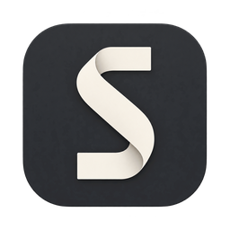

<p align="center"></p>

<h1 align="center">Skinny</h1>

<p align="center">A Markdown scratchpad for the Mac that copies out as clean rich text.<br>Write Markdown, press ⌘C, paste into Outlook, Teams, Word or Gmail, and it looks like it belongs there.</p>

---

Most Markdown tools are good at writing and bad at the last step: getting formatted text into an email or a chat without dragging along fonts, colors and odd spacing. Skinny exists for that step. It copies **bare semantic HTML** (headings, lists, tables, emphasis, links, code), so the paste takes on the destination's own styling. If you keep opening VS Code just to preview and copy, Skinny replaces that.

## Features

- **Copy as Rich Text (⌘C).** Copies the whole document, or just the selection, as clean HTML plus the Markdown, tuned against new Outlook, Outlook for Mac and Teams first.
- **Copy as Markdown (⇧⌘C)** and **Copy as HTML (⌥⌘C)**, for when you want the source.
- **Paste as Markdown (⌘V).** Rich text from Word, Outlook, Gmail, Google Docs or a web page lands as tidy Markdown. **⌥⇧⌘V** pastes plain text.
- **Live preview** that follows the editor's scroll, with syntax-highlighted code blocks.
- **A real editor** (CodeMirror 6): multiple cursors, find and replace, native Mac text navigation, spell check, dictation and Writing Tools.
- **Never asks to save.** Saved files autosave in place. Unsaved Scratch Documents come back on relaunch with their undo history, and closed ones wait in Recently Closed (⇧⌘T) for 30 days.
- **Tabs, themes and zoom.** Light and dark themes that follow the system, and ⌘+ / ⌘− / ⌘0 zoom for the whole window.
- **Automatic updates** from GitHub Releases. Choose **Skinny → Check for Updates…** to check now.

Skinny edits your Markdown as plain text and never rewrites anything you typed. There's no WYSIWYG.

## Install

Requires **macOS 26**.

1. Download `Skinny-<version>.zip` from the [latest release](https://github.com/asharism/skinny-dip/releases/latest).
2. Unzip it and drag **Skinny** to Applications.
3. Open it once. Skinny isn't notarized yet, so macOS blocks the first launch. Go to **System Settings → Privacy & Security** and click **Open Anyway**. Or, in Terminal:
   ```sh
   xattr -dr com.apple.quarantine /Applications/Skinny.app
   ```

After that, Skinny updates itself. When a new version is out, it offers to install it, and you only do the first-launch step once. macOS may ask for microphone and speech permission again after an update, if you use dictation.

## Build from source

You need Xcode 26 and [XcodeGen](https://github.com/yonaskolb/XcodeGen) (`brew install xcodegen`).

```sh
xcodegen generate                       # SkinnyDip.xcodeproj is generated, never committed
open SkinnyDip.xcodeproj                # scheme: SkinnyDip, product: Skinny.app

# Core logic tests (fast, no simulator)
swift test --package-path Packages/MarkdownCore

# App build and full test suite
xcodebuild test -scheme SkinnyDip -destination 'platform=macOS,arch=arm64' -derivedDataPath .build/xcode
```

All Markdown, HTML and paste logic lives in the `Packages/MarkdownCore` Swift package and is tested with golden files: `input.md` → `expected.html` for copying out, and `captured.html` → `expected.md` for pasting in. The app target is a thin SwiftUI shell around it.

## Releasing

```sh
scripts/release.sh 0.2.0              # test, build, sign, tag v0.2.0, publish the GitHub Release
scripts/release.sh 0.2.0 --dry-run    # build and sign into dist/ without publishing
```

The script runs from a clean, up-to-date `main` and needs `gh` to be logged in. It attaches `Skinny-<version>.zip` and a Sparkle `appcast.xml` to the release, and installed copies pick it up from there. Updates are signed with an EdDSA key kept in the maintainer's login keychain, and that key must never be lost or regenerated (see [ADR-0009](docs/adr/0009-github-releases-with-sparkle-ad-hoc-signed.md)).

## Project docs

| | |
|---|---|
| [`GLOSSARY.md`](GLOSSARY.md) | The project's vocabulary (Bare HTML, Scratch Document, Paste Target, …) |
| [`docs/adr/`](docs/adr/) | Architecture decisions and why they were made |
| [`docs/build-plan.md`](docs/build-plan.md) | The original plan the app was built from (historical) |
| [`docs/design/ui-shell.md`](docs/design/ui-shell.md) | Window, Tabs, Cards and themes |
| [`docs/paste-matrix/`](docs/paste-matrix/) | The by-hand paste test each release runs against Outlook, Teams, Word, Gmail and others |
| [`CLAUDE.md`](CLAUDE.md) | Working guide for contributors and coding agents |

## License

[MIT](LICENSE)
